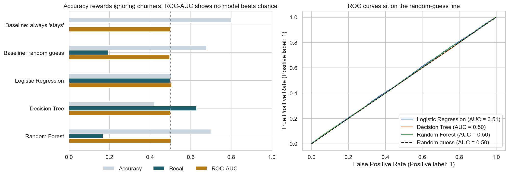
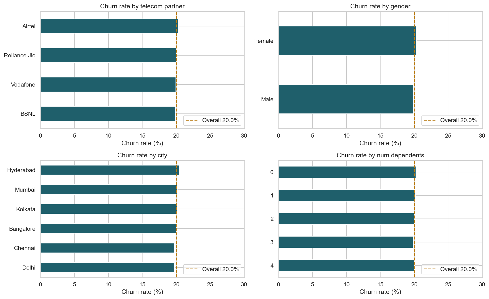

# Telecom Customer Churn Analysis

**Can we predict which telecom customers will leave? With this data, no — and showing why is the main result.**

About 1 in 5 of 243,553 customers churned (20.05%). After cleaning the data, testing every feature and comparing three models against dummy baselines, no model beats random guessing (ROC-AUC ≈ 0.50). The data also shows clear signs of being synthetic.



## Business question
A telecom company wants to find customers who are likely to leave, so it can target them with retention offers before they go. Which customers are at risk, and what drives churn?

## Data
- **Source:** Telecom Customer Churn dataset, Kaggle
- **Size:** 243,553 customers × 14 columns
- **Key fields:** telecom partner (Jio, Airtel, Vodafone, BSNL), gender, age, state, city, registration date, number of dependents, estimated salary, calls made, SMS sent, data used, churn (0/1)

## Approach
1. **Data quality checks:** no missing values or duplicates. Found impossible negative usage values in 2.5–3% of records (calls, SMS, data), and found that city and state rarely agree (customers in Karnataka listed in Kolkata).
2. **Exploratory analysis:** churn *rates* (not counts) by provider, gender, city and family size; distributions; correlation; monthly churn trend.
3. **Statistical tests:** chi-square with Cramér's V for categorical features, Mann-Whitney U for numeric ones, judged on effect size as well as p-value.
4. **Modelling:** stratified 80/20 split, then a scikit-learn pipeline fitted on training data only (median imputation of invalid values, min-max scaling, one-hot encoding). Logistic Regression, Decision Tree and Random Forest compared against two dummy baselines on recall and ROC-AUC, with 5-fold cross-validation.

## Key findings
1. **Churn is about 20% everywhere.** Every provider, gender, city and family size is within about a point of the overall rate.
2. **No feature is associated with churn.** All effect sizes are negligible (below 0.1).
3. **No model beats chance.** ROC-AUC is about 0.50 for every model, and cross-validation confirms it.
4. **Accuracy was misleading.** In my first version, a Random Forest scored 79.95% accuracy while catching **0 of 9,765** churners in the test set. It simply predicted "stays" for everyone, which is exactly what the "always stays" baseline does.



## Recommendations
- **Don't deploy a churn model trained on this data.** It would be no better than chance, and retention offers based on it would be wasted.
- **Collect the signals that usually drive telecom churn:** prepaid vs postpaid, plan price and changes, recharge frequency, number-porting requests, complaints, and network quality.
- **Track churn rate by cohort and segment** in a dashboard, so changes show up once richer data exists.

## Limitations
- The dataset appears synthetic (uniform distributions, city–state mismatches), so the findings describe this file, not real customers.
- There is no churn date, so I can't analyse when in the customer lifecycle people leave.

## What I learned
My first version of this project reported that "machine learning can help predict customer churn". Re-checking it against baselines showed the opposite. The most useful skill here was not building the models, but checking whether their results meant anything.

## Files
| File | What it is |
| --- | --- |
| `telecom_churn_analysis.ipynb` | Full analysis (runs top to bottom) |
| `telecom_churn.csv` | Dataset |
| `images/` | Charts used in this README (created when the notebook runs) |
| `requirements.txt` | Python packages |

## How to run
```
pip install -r requirements.txt
jupyter notebook telecom_churn_analysis.ipynb
```

**Tools:** Python, Pandas, NumPy, Matplotlib, Seaborn, SciPy, Scikit-learn
